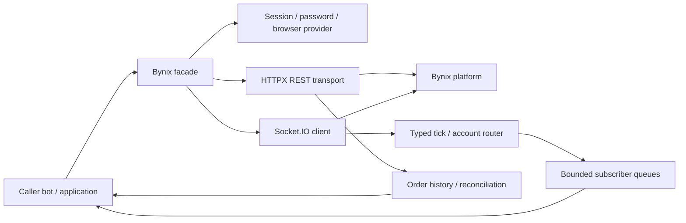
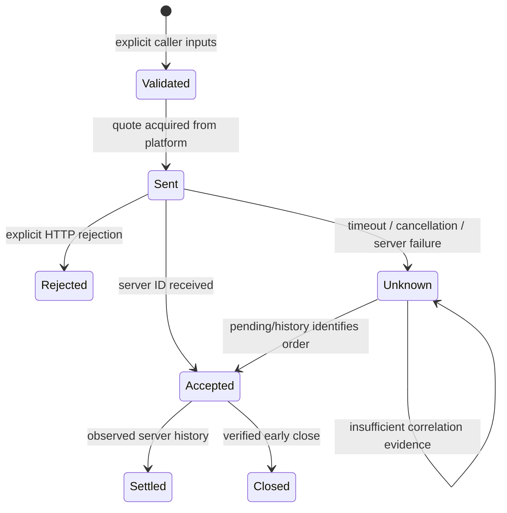

# Architecture and recovery

Each facade instance owns its token, HTTP pool, Socket.IO connection, refresh lock,
subscription registry, account default and bounded acknowledged-order lookup. Account
state is not stored in module globals. External code owns trading decisions.

## Authentication

The account token is a secret, distinct from the Engine.IO and Socket.IO session IDs.
Import it explicitly or obtain it through a configured provider. A failed GET with HTTP
401 may trigger a single-flight provider refresh. Concurrent callers observe the new
session rather than all logging in at once. POST operations are not silently retried.
Providers are explicit: no background browser is launched unless configured.

## Streams

The upstream client handles Engine.IO framing and heartbeat. On reconnect, registered
market subscriptions and the account token are emitted again. Connection events disclose
a possible gap; history resynchronization belongs to the caller. A reconnect does not
guarantee delivery of all missing ticks.

Each consumer has a bounded queue. Overflow terminates delivery with StreamOverflow.
Consumers must close their subscription and reconcile history before resubscribing.
Server timestamps retain their original documented unit; no unreliable cross-clock
latency claim is made by subtracting an uncalibrated local wall clock.

## Order lifecycle

client_ref is a correlation aid, not a verified idempotency key. Acknowledged platform IDs
are retained for the latest 1,000 references in this client process. Persist IDs in the
application if recovery across restarts is required. Settled history currently omits
client_ref, so an uncertain submission cannot always be disambiguated. Do not turn a
missing history match into an automatic retry.

## Network configuration

HTTP CONNECT proxies apply to both REST and Socket.IO. Static DNS overrides substitute
only the TCP destination; original hostnames remain in HTTP and TLS verification.
Proxy and DNS override settings are mutually exclusive. PasswordAuth has its own network
settings and should be configured consistently. Browser routing has separate browser
configuration and is not asserted to inherit the SDK's transport settings.

connect_any is a login-time trusted-host chain. It never forwards an existing token to a
new hostname. It retries transport failure; credentials denial or rate limiting stops
the chain. Running orders do not migrate automatically to another host.
